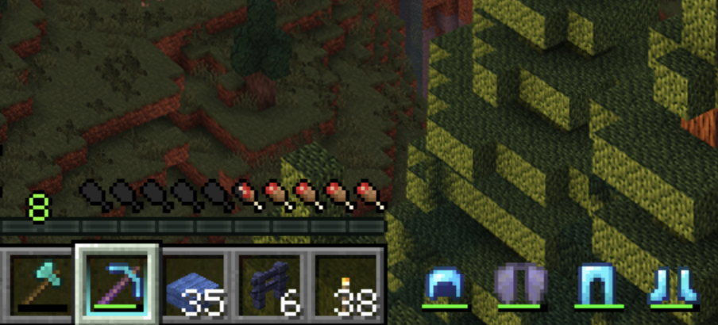

# Worn Gear

A NeoForge 1.21.1 client mod. Worn armor and the elytra show up just to the right of the hotbar, each with a durability bar.

## Download

- [worngear-1.0.0.jar](https://github.com/dboundz/mc-worn-gear/raw/main/dist/worngear-1.0.0.jar)

Needs Minecraft **1.21.1** and NeoForge **21.1.265**. Put the jar in the `mods` folder on your client, then restart. It does not go on the server.

## What it can do

- Draws each worn item beside the hotbar: helmet, chest, legs, then boots. An empty slot is skipped, so an elytra by itself is one icon.
- Puts the usual durability bar under anything that wears out. The bar is full and green when the item is fresh, and it gets shorter and redder as the item is damaged.
- Hides with the rest of the interface when you press F1.

## What it cannot do

- It does not show an empty armor slot, the offhand, or the hotbar.
- It does not show a number, only the bar.
- An item with no durability, such as a carved pumpkin on your head, shows the icon and no bar.
